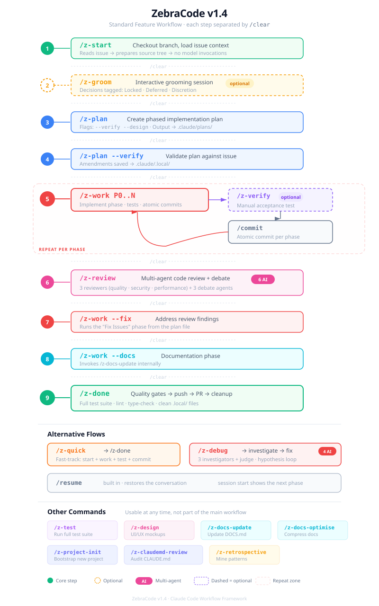

# ZebraCode v1.4

A structured workflow framework for [Claude Code](https://docs.anthropic.com/en/docs/claude-code). Brings opinionated, repeatable workflows to AI-assisted software development — with plans, phases, multi-agent reviews, session persistence, and automated quality gates.

### What makes it different

| Principle | What it means |
|-----------|---------------|
| **Evidence-based verification** | Every skill that claims progress must show concrete proof — test counts, linter output, `file:line` citations. No bare checkmarks, no "it works." |
| **Least-privileged tool access** | Review and debug agents get read-only tools (Read, Grep, Glob). Only the main session modifies code. Agents can't accidentally break things. |
| **Workflow state validation** | A Stop hook asks Claude to confirm before stopping with unchecked items in a started phase. Permission rules block edits to protected files and ask before destructive commands. |
| **Decision enforcement** | Grooming decisions are categorized as Locked, Deferred, or Discretion. Locked decisions map to plan actions. Deferred items are never implemented unless re-categorized. |
| **Persistent project patterns** | Conventions, pitfalls, and shortcuts discovered during work are recorded in `.claude/project-patterns.md` (with user approval) and retained across sessions and branches. |
| **Full audit trail** | Plan files contain per-phase Work Logs — append-only entries with commit hashes, skill references, and `file:line` citations that survive `/clear` and context compaction. |
| **Automated self-reflection** | Before claiming a phase complete, the agent silently evaluates: Did I verify behavior or just confirm code exists? Did I deviate from the plan? Would I flag this in review? |
| **Optimized CLAUDE.md** | Global instructions enforce verification-first development, debugging discipline, security boundaries, and context management — reviewed and tuned via `/z-claudemd-review`. |

## Table of Contents

- [Prerequisites](#prerequisites)
- [Installation](#installation)
- [Project Setup](#project-setup)
- [Workflow Guide](#workflow-guide)
- [Skill Reference](#skill-reference)
- [Hook Reference](#hook-reference)
- [Agent Reference](#agent-reference)
- [Configuration](#configuration)
- [Troubleshooting](#troubleshooting)

---

## Prerequisites

### Required

| Tool | Purpose |
|------|---------|
| [Claude Code](https://docs.anthropic.com/en/docs/claude-code) | CLI agent (ZebraCode is a framework on top of it) |
| `jq` | JSON parsing in hook scripts (`brew install jq`) |
| `terminal-notifier` | Desktop notifications on macOS (`brew install terminal-notifier`) |
| [Context7](https://github.com/upstash/context7) MCP | Framework/library documentation lookup (required by `/z-plan`, `/z-work`, `/z-review`) |

### Recommended MCPs

| MCP | Purpose | Scope |
|-----|---------|-------|
| [Statusline](https://github.com/anthropics/claude-code-statusline) | Status bar showing branch, plan progress | Global |
| [Serena](https://github.com/oraios/serena) | Semantic code retrieval/editing | Global |

### Optional MCPs

| MCP | Purpose | When needed |
|-----|---------|-------------|
| Jira MCP | Issue tracker integration | Jira projects |
| Laravel Boost | Enhanced Laravel support | Laravel projects |

### Plugins

| Plugin | Purpose | When needed |
|--------|---------|-------------|
| `frontend-design@claude-plugins-official` | Claude's design skill — design plan, generic-default checks, self-critique | `/z-design` mockups (`install.sh` offers to install it) |

> **Tip**: Use project-scope MCP configuration where possible to avoid loading unused MCPs globally.

---

## Installation

### Quick Install

```bash
git clone https://github.com/janark147/zebracode ~/zebracode
cd ~/zebracode
./install.sh
```

### Manual Install

Copy framework files to your Claude Code config directory:

```bash
# Skills
cp -r skills/ ~/.claude/skills/

# Agents
cp -r agents/ ~/.claude/agents/

# Hooks
cp -r hooks/ ~/.claude/hooks/
chmod +x ~/.claude/hooks/*.sh

# Templates
cp -r templates/ ~/.claude/templates/

# Status line
cp statusline.sh ~/.claude/statusline.sh
chmod +x ~/.claude/statusline.sh

# Global instructions (review before overwriting — may contain your own customizations)
# cp CLAUDE.md ~/.claude/CLAUDE.md
# cp RULES.md ~/.claude/RULES.md
```

Then merge the hooks, permission rules and `attribution` setting from `settings.json.example` into your `~/.claude/settings.json`. See [Configuration](#configuration).

---

## Project Setup

After installing ZebraCode globally, initialize it for each project:

```
cd /path/to/your/project
/z-project-init
```

This runs an interactive questionnaire that:
1. Auto-detects your stack (language, framework, test runner, formatter)
2. Asks about issue tracker, git conventions, and tooling preferences
3. Creates `.claude/z-project-config.yml` with your answers
4. Writes protected files and dangerous commands as permission rules in `.claude/settings.json`
5. Creates `.claude/.gitignore` (ignores `.local/` ephemeral state)

Both files are committed to git so all team members share the same ZebraCode configuration and protections.

---

## Workflow Guide

<p align="center">
  
</p>

**Key principle**: Run `/clear` between each skill invocation. Context is preserved via plan files and git history — not the conversation window.

---

## Skill Reference

### Core Workflow

| Skill | Description | Arguments |
|-------|-------------|-----------|
| `/z-start` | Checkout branch, read issue, prepare workspace | `[issue]` |
| `/z-groom` | Interactive issue grooming with decision categorization | `[issue]` |
| `/z-plan` | Create implementation plan with phases and must-haves | `[issue] [--verify] [--design]` |
| `/z-design` | Generate UI/UX design mockups (standalone or via Phase 0) | `[issue]` |
| `/z-work` | Implement the next phase(s) of the plan | `[issue] [phase...] [--fix] [--docs]` |
| `/z-verify` | Verify phase implementation against acceptance criteria | `[issue] [phase]` |
| `/z-review` | Multi-agent code review with optional debate ring | `[branch/issue-id]` |
| `/z-done` | Quality gates, push, PR creation, cleanup | — |

To continue an earlier conversation, use Claude Code's built-in `/resume` (or `claude --resume`). After `/clear` or in a new session, the SessionStart hook shows the plan's next phase and the `/z-work` command for it.

### Alternative Flows

| Skill | Description | Arguments |
|-------|-------------|-----------|
| `/z-quick` | Fast-track: start + implement + test + commit | `[issue] [branch]` |
| `/z-debug` | Multi-agent bug investigation with hypothesis testing | `[issue-id \| resume] [branch]` |

### Documentation & Quality

| Skill | Description | Arguments |
|-------|-------------|-----------|
| `/z-test` | Run test suite and fix failures | `[backend/frontend]` |
| `/z-docs-update` | Update DOCS.md with changes from branch | `[issue]` |
| `/z-docs-optimise` | Optimize documentation for conciseness and clarity | `[file-path]` |
| `/z-claudemd-review` | Audit and improve project CLAUDE.md | — |
| `/z-retrospective` | Analyze workflow artifacts for recurring patterns | — |

### Utilities

| Skill | Description | Arguments |
|-------|-------------|-----------|
| `/commit` | Create a commit (short message, never credits AI) | `[message]` |
| `/z-project-init` | Initialize ZebraCode for a new project | — |

---

## Hook Reference

All hooks are shell scripts in `~/.claude/hooks/`. They're wired via `~/.claude/settings.json`.

| Hook | Event | Tool Match | Behavior |
|------|-------|------------|----------|
| `workflow-state.sh` | SessionStart | — | Injects workflow progress bar and next-step suggestion (also after `/clear` and compaction) |
| `verify-tasks-complete.sh` | Stop | — | Asks Claude to confirm once before stopping when a started phase has unchecked items |
| `notify-user.sh` | Notification | — | Desktop notification (macOS `terminal-notifier`) |

`workflow-state.sh`, `verify-tasks-complete.sh` and `statusline.sh` share `hooks/lib/plan.sh`, which finds the plan for a branch (`feature/TAL-1` → `.claude/plans/TAL-1-*.md`) and counts only `## Phase <number>` sections.

Protected files and dangerous commands are not hooks — they are `permissions.deny` and `permissions.ask` rules (see [Settings](#settings-claudesettingsjson)). Formatting runs once per phase in `/z-work`'s quality checks and in `/commit`, not after every edit.

### Hook API Notes

- Hooks receive context via **JSON on stdin** (not command-line arguments)
- Parse with `jq`: e.g., `jq -r '.tool_input.file_path'` or `jq -r '.tool_input.command'`
- SessionStart plain stdout is added to Claude's context. For most other events plain stdout only goes to the debug log — return `hookSpecificOutput.additionalContext` in JSON to reach Claude
- Stop hooks get `stop_hook_active: true` when Claude is already continuing because of a stop hook — allow the stop then, or the turn never ends

---

## Agent Reference

ZebraCode includes 10 custom agent definitions for multi-agent workflows.

### Review Agents (spawned by `/z-review`)

| Agent | Focus | Model |
|-------|-------|-------|
| `z-reviewer-quality` | Code quality, patterns, maintainability | Opus |
| `z-reviewer-security` | Security vulnerabilities, OWASP, data exposure | Opus |
| `z-reviewer-performance` | Performance bottlenecks, N+1 queries, caching | Opus |

### Debate Agents (spawned by `/z-review` debate ring)

| Agent | Personality | Model |
|-------|-------------|-------|
| `z-debate-pragmatist` | Practical, trade-off focused, ships features | Opus |
| `z-debate-adversary` | Adversarial, edge-case hunter, worst-case thinker | Opus |
| `z-debate-architect` | Big-picture, system design, long-term implications | Opus |

### Debug Agents (spawned by `/z-debug`)

| Agent | Focus | Model |
|-------|-------|-------|
| `z-debug-investigator-state` | Data flow, state management, caching issues | Opus |
| `z-debug-investigator-logic` | Edge cases, boundary values, off-by-one errors | Opus |
| `z-debug-investigator-integration` | API contracts, middleware, cross-service issues | Opus |
| `z-debug-judge` | Synthesizes investigator reports, ranks hypotheses | Opus |

All agents use **read-only tools** (Read, Grep, Glob) — they cannot modify files. Only the main Claude Code session makes changes.

---

## Configuration

### Project Config: `z-project-config.yml`

Created by `/z-project-init` in your project's `.claude/` directory. Key sections:

```yaml
project:
  name: "my-project"

git:
  target_branch: "main"
  branch_prefix: "feature/"

issue_tracker:
  type: "github"          # github | jira | linear | none

stack:
  language: "typescript"
  framework: "nextjs"
  frontend: "react"
  test_runner_backend: "jest"
  formatter: "prettier"

commands:
  test_backend: "npm test"
  lint: "npm run lint"
  format: "npx prettier --write"
  typecheck: "npx tsc --noEmit"
```

### Project Permissions: `.claude/settings.json`

Also written by `/z-project-init`. Protected files are `deny` rules, dangerous commands are `ask` rules (Claude Code asks you every time, even in auto mode):

```json
{
  "permissions": {
    "deny": ["Edit(.env)", "Edit(.env.*)", "Edit(/storage/**)", "Edit(*.pem)"],
    "ask": ["Bash(*artisan migrate:fresh*)", "Bash(*wrangler delete*)"]
  }
}
```

`Edit(...)` rules also cover the Write tool and shell redirects such as `> .env`. A bare file name matches at any depth; a leading `/` anchors a path to the project root.

### Global Instructions

- **`~/.claude/CLAUDE.md`**: Framework behavior rules (plan usage, verification, debugging)
- **`~/.claude/RULES.md`**: Actionable operational rules (task management, file safety, agent access)

### Settings: `~/.claude/settings.json`

The `settings.json.example` file contains the complete configuration. Key settings:

- `attribution: false`: No AI co-author trailer, PR text or session link in commits and PRs (Claude Code v2.1.281+)
- `permissions.deny`: `.env` files and lock files can't be edited in any project
- `permissions.ask`: database wipe commands, force pushes and `git reset --hard` always ask first

---

## File Structure

### User-Global (`~/.claude/`)

```
~/.claude/
├── CLAUDE.md              # Global instructions
├── RULES.md               # Operational rules
├── settings.json          # Hooks, permission rules, settings
├── skills/                # 17 skill directories (SKILL.md + references/)
├── agents/                # 10 agent definitions
├── hooks/                 # 3 hook scripts + lib/plan.sh
├── templates/             # Config templates
└── statusline.sh          # Status bar script
```

### Per-Project (`{project}/.claude/`)

```
{project}/.claude/
├── z-project-config.yml   # Stack + tool config (committed)
├── settings.json          # Permission rules: protected files, dangerous commands (committed)
├── project-patterns.md    # Accumulated patterns (committed)
├── plans/                 # Plan files — like ADRs (committed)
├── .gitignore             # Contains: .local/
└── .local/                # Ephemeral state (gitignored)
    ├── {branch}-debug.md
    └── mockups/{issue}/   # /z-design mockup files
```

---

## Troubleshooting

### Skills not appearing

- Verify skill files exist: `ls ~/.claude/skills/*/SKILL.md`
- Each skill must be in its own directory: `skills/{name}/SKILL.md`
- Front-matter must be valid YAML between `---` delimiters

### Hooks not firing

- Check `~/.claude/settings.json` has the hooks section (compare with `settings.json.example`)
- Verify scripts are executable: `chmod +x ~/.claude/hooks/*.sh`
- Test hooks manually: `echo "{\"cwd\":\"$PWD\"}" | ~/.claude/hooks/workflow-state.sh`
- Check `jq` is installed: `which jq`

### Formatter not running

- `/z-work` runs the formatter once per phase (Step 5, Quality Checks), and `/commit` runs it before committing
- Ensure `stack.formatter` or `commands.format` is set in `z-project-config.yml` (e.g., `npx prettier --write`)
- The formatter must be installed in the project (`npm install`)

### "Not on target branch" errors

- Skills like `/z-plan` require you to be on a feature branch, not `main`/`master`
- Run `/z-start` first to create/checkout the feature branch

### Protected file blocked unexpectedly

- Run `/permissions` to see which `deny` rule matched and which settings file it comes from
- Global rules are in `~/.claude/settings.json`, project rules in `.claude/settings.json`
- A deny rule can't be overridden by an allow rule — to edit a protected file intentionally, remove its rule temporarily, or edit the file yourself

### Context lost after `/clear`

- This is expected — context is preserved via files, not conversation history
- Plan files in `.claude/plans/` track all progress
- Use `/resume` to continue an earlier conversation
- The SessionStart hook shows current workflow state automatically

### Multi-agent review timeout

- `/z-review` runs its 3 review agents for 2 passes (a third only when pass 2 still finds more than 5 new issues), each reviewer seeing the whole diff, then a verification round for findings below 70% confidence, plus 3 optional debate agents — this takes time
- All agents use the `opus` model alias, which resolves to the current Opus model. To use a different model, change `model:` in `~/.claude/agents/z-*.md`
- If `/z-review` or `/z-debug` reports that its agent types are not available, run `claude --debug` and look for skipped files in `~/.claude/agents/` — every agent file needs both `name` and `description` in its frontmatter
- The agents are ordinary subagents; they don't need the experimental agent-teams setting

---

## License

Apache 2.0
